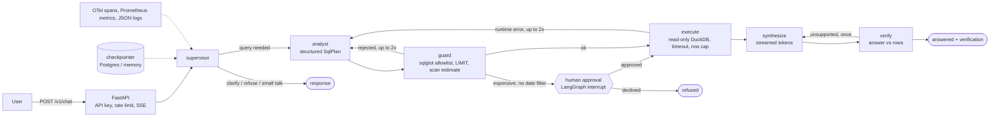

# analyst-agent: a guarded, evaluated LLM agent over a SQL warehouse

An analytics assistant that turns questions into SQL over the weather marts built by
[elt-modern-data-stack](https://github.com/Tajaddin/elt-modern-data-stack), with the controls that make an
agent deployable: a parsed SQL allowlist, human approval for expensive queries, per-thread memory in
Postgres, traces and metrics for every node, a golden-set evaluation that gates CI, and Terraform for AWS.

Built with LangGraph 1.x, LangChain structured outputs (Anthropic API or Amazon Bedrock), FastAPI, DuckDB,
sqlglot, OpenTelemetry, Prometheus, Grafana, k6 and Terraform. Python 3.12, MIT licence.

## What it does



Every node is one OpenTelemetry span under `agent.turn`, which sits under the FastAPI server span, so one
chat request is one trace in Tempo (or Langfuse, which accepts the same OTLP export).

A turn with the fake provider:

```bash
$ analyst-agent ask "Which state had the highest average maximum temperature on 2026-10-12?"
{
  "status": "answered",
  "answer": "Result: state=AR, avg_tmax_c=33.002666666666656. (1 row returned.)",
  "sql": "SELECT state, avg_tmax_c FROM main_marts.mart_daily_state_summary WHERE obs_date = CAST('2026-10-12' AS DATE) AND NOT avg_tmax_c IS NULL ORDER BY avg_tmax_c DESC LIMIT 1",
  "result": {"columns": ["state", "avg_tmax_c"], "rows": [["AR", 33.002666666666656]], "row_count": 1, "truncated": false, "elapsed_ms": 2.1},
  "verification": {"supported": true, "issues": []},
  "usage": {"input_tokens": 0, "output_tokens": 0, "llm_calls": 4, "cost_usd": 0.0},
  "latency_ms": 31.4
}
```

The same thread then understands "And the lowest?" because the earlier turns are in the checkpointer.
A question like "How many station-day rows are there in total?" scans 232,116 rows with no date filter, so
the response is `approval_required` with the SQL and the estimate, and the thread waits for
`POST /v1/threads/{id}/approve`.

## Measured

All numbers below were produced by committed scripts on 2026-10-17 and can be re-run. **The fake provider
replays the golden set's own SQL, so these figures measure the pipeline (guard, execution, memory, API),
not any model's quality.** Live-provider numbers appear in `evals/results/latest-anthropic.md` once a key
has been used to run `make evals-live`.

### Evaluation gate (`make evals`, fake provider, in-process, MemorySaver)

| Metric | Value |
|---|---|
| Turns scored | 67 (48 gold-SQL questions, 8 behaviour cases, 6 conversations with 11 turns) |
| Execution accuracy (agent rows = gold rows) | 100% (n=57) |
| Behaviour accuracy (clarify / refuse / direct) | 100% (n=10) |
| Approval accuracy (interrupt fires exactly when expected) | 100% (n=6) |
| Conversation pass rate (memory-dependent follow-ups) | 6/6 |
| Latency p50 / p95 per turn | 27.8 ms / 36.7 ms |
| Model calls per turn | 3.57 |

Source: `evals/results/latest-fake.md`. The gate (`evals/baseline.json`) requires 100% on all four for the
fake provider because any miss is a pipeline bug.

### Load (`make load`: k6 inside the compose network, fake provider, Postgres memory, 10 virtual users, 60 s)

| API processes | Requests | Throughput | p50 | p95 | Failed |
|---|---|---|---|---|---|
| 1 uvicorn worker (the default image) | 1,235 | 20.4 req/s | 419 ms | 520 ms | 0 |
| 4 uvicorn workers | 2,337 | 38.7 req/s | 146 ms | 247 ms | 0 |

Source: `load/results/k6-10vu-60s-{1worker,4workers}.json`. The single-process number is the honest one
for the shipped image: a turn costs about 45 ms of Python CPU (sqlglot, LangGraph, DuckDB, checkpoint
serialisation), so one process saturates near 20 turns/s and latency under 10 concurrent users is queueing.
The deployment scales by adding ECS tasks rather than workers so that each task's Prometheus metrics stay
whole (see limitations). Host: Windows 11, Docker Desktop, i7, 20 threads.

### Tests and checks

| Check | Count / result |
|---|---|
| Unit + integration tests (`make test`) | 74 passed, 88% line+branch coverage (CI floor 85%) |
| Postgres memory tests (`make test-pg`) | 2 passed against the compose database: history and a pending approval survive a process restart |
| Alert rules (`make alerts-test`) | 5 rules, 7 promtool unit tests, all firing and silent as specified |
| Static | ruff, ruff format, mypy `--strict` on the package, gitleaks, `terraform validate` |
| Image | 671 MB, non-root user, health check, built and asked a question in CI |

## Quick start

```bash
uv sync --all-extras
uv run python scripts/build_demo_warehouse.py        # 10 MB DuckDB from the committed data/sample Parquet
cp .env.example .env
uv run analyst-agent ask "How many stations are in Florida?"
uv run analyst-agent serve                           # http://localhost:8000/docs
make test && make evals                              # the full local gate, no key needed
```

With Docker: `make up` (API + Postgres), `make up-obs` (adds OTel collector, Tempo, Prometheus, Alertmanager,
Grafana with the provisioned dashboard at http://localhost:3000), `make load`, `make down`.
See [docs/DEPLOY.md](docs/DEPLOY.md) for AWS.

Real models: `AGENT_PROVIDER=anthropic` with `ANTHROPIC_API_KEY`, or `AGENT_PROVIDER=bedrock` with AWS
credentials. The model, pricing used for the cost figure, row limits, approval threshold, rate limit and
API keys are all settings (`src/analyst_agent/config.py`, `AGENT_*` variables).

## API

| Method and path | Purpose |
|---|---|
| `POST /v1/chat` | One turn on a thread; returns status, answer, SQL, rows, verification, usage, latency |
| `POST /v1/chat/stream` | Same as SSE: `node` events as the graph advances, `token` events from the synthesizer, one `done` event |
| `POST /v1/threads/{id}/approve` | Answer a pending approval (`{"approved": true|false}`); 409 when nothing is pending |
| `GET /v1/threads/{id}` | The thread's user/assistant history |
| `GET /healthz`, `GET /readyz` | Liveness; readiness checks the warehouse file and the Postgres pool |
| `GET /metrics` | Prometheus exposition |

Authentication is `X-API-Key` (any of `AGENT_API_KEYS`; an empty list means open, for local use only).
The chat endpoints are rate limited per key (`AGENT_RATE_LIMIT`, default 30/minute); probes are not.
Statuses: `answered`, `clarify`, `refused`, `approval_required`, `error`.

## Evaluations

`evals/golden/questions.yaml` holds 48 questions with gold SQL and 8 behaviour-only cases;
`evals/golden/conversations.yaml` holds 6 threads whose later turns need memory. `evals/run_evals.py`
runs them through the full service and scores execution accuracy (result rows equal the gold query's
rows, order-insensitive, numeric tolerance), behaviour, approvals, conversations, latency, calls, tokens
and cost. It writes `evals/results/latest-<provider>.{json,md}` and `--gate` fails the build below
`evals/baseline.json`. `--judge` adds an LLM judge with its own prompt (recorded, never gated, costs
money). CI runs the fake gate on every push; the live gate is a manual workflow that only runs when the
`ANTHROPIC_API_KEY` secret exists.

## Observability

- **Logs**: structlog JSON to stdout; `turn.done` carries thread, status, latency, model calls, cost, rows.
- **Metrics** (`/metrics`): requests by status, latency histogram, tokens by direction, estimated cost,
  model calls, guard decisions, rows per query. Five alert rules (`observability/alert_rules.yml`): down,
  error share > 5%, p95 > 20 s, spend > $1/hour, guard rejection share > 30%; each has a promtool unit test.
- **Traces**: one span per graph node with attributes (repair count, rows, SQL time) under the FastAPI span,
  exported over OTLP/HTTP when `OTEL_EXPORTER_OTLP_ENDPOINT` is set.
- **Dashboard**: `observability/grafana/dashboards/analyst-agent.json`, provisioned by compose: turns by
  status, p50/p95, spend, error share, tokens, guard decisions, calls per turn, rows histogram, Tempo link.

## Security

- The model never touches the database: it proposes SQL, `guard.py` parses it with sqlglot and allows one
  `SELECT` over allowlisted tables with no table functions and an enforced `LIMIT`; `warehouse.py` runs it
  on a read-only connection with a wall-clock timeout and a row cap. Expensive scans need a human.
- Secrets only in the environment (`.env` is gitignored, `.env.example` documents it) or AWS Secrets Manager;
  in AWS the task role calls Bedrock, so no model API key exists in the cloud.
- Input validation on every request body (thread id pattern, message length), API-key auth, per-key rate
  limiting, CORS off unless configured, non-root container, pinned dependencies (`uv.lock`), pinned images
  and actions, Dependabot for uv, Actions, Docker and Terraform, gitleaks in CI.

## Repository layout

```
src/analyst_agent/   config, schemas, guard, warehouse, llm (planners), graph, service, api, cli, metrics, tracing, logging
evals/               golden set, conversations, runner, scoring, judge, baseline, results
tests/               unit (guard, warehouse, llm, graph, tracing) and integration (API, Postgres memory)
observability/       prometheus, alert rules + tests, alertmanager, otel collector, tempo, grafana provisioning
load/                k6 script and results
infra/aws/           Terraform: VPC, ECS Fargate, ALB, RDS, Secrets Manager, Bedrock IAM, GitHub OIDC, teardown
docs/                PLAN, DEPLOY, decisions/0001-0005 (ADRs)
scripts/             build_demo_warehouse.py, teardown.sh
```

## Limitations, stated plainly

- Every quality number above comes from the fake provider and says nothing about a model; the live
  thresholds in `evals/baseline.json` are placeholders until the first real run sets them.
- 48 questions over one 12-day dataset is a smoke-level golden set, not a benchmark, and execution
  accuracy cannot detect a wrong query that happens to return the right rows.
- Prometheus counters are per process; the image runs one worker and the stack scales by tasks.
- The AWS listener is HTTP (no domain, no certificate), and AWS has logs but not the trace/metrics stack.
- Histories are kept whole with no summarisation or retention policy.
